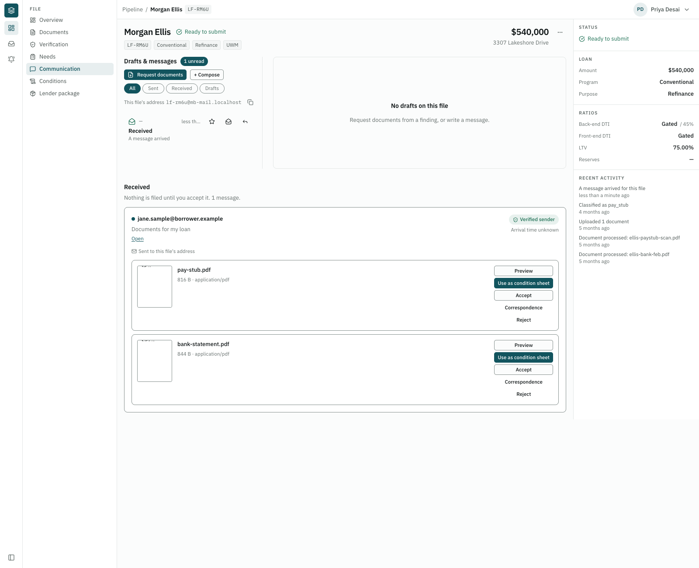
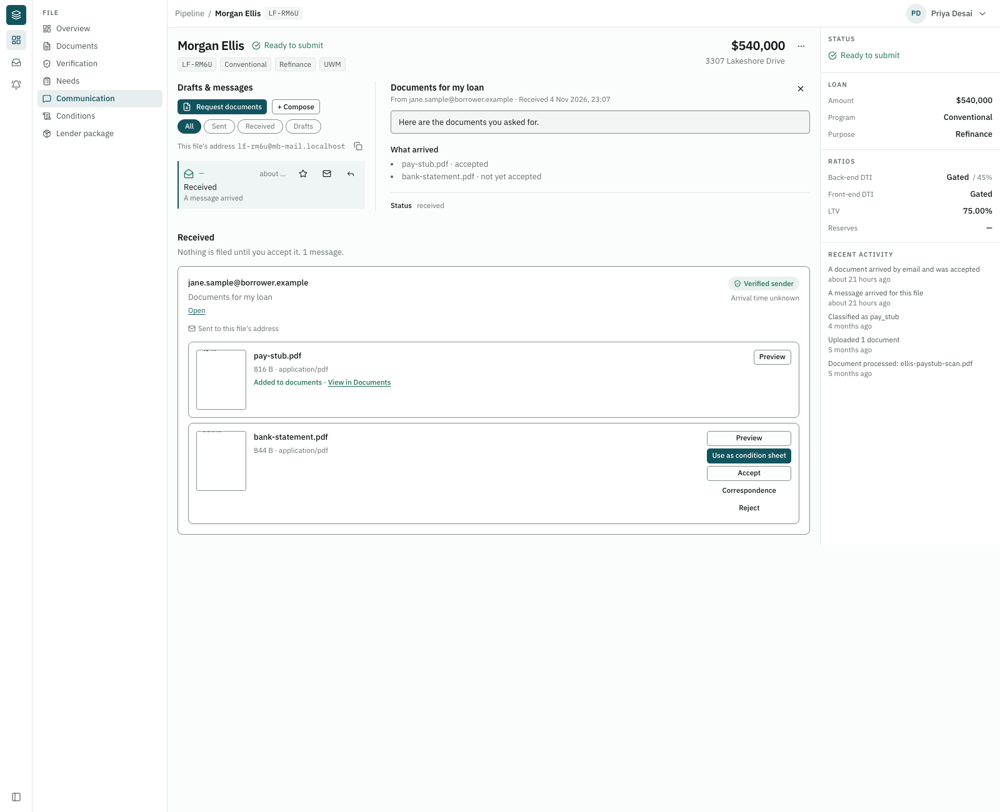
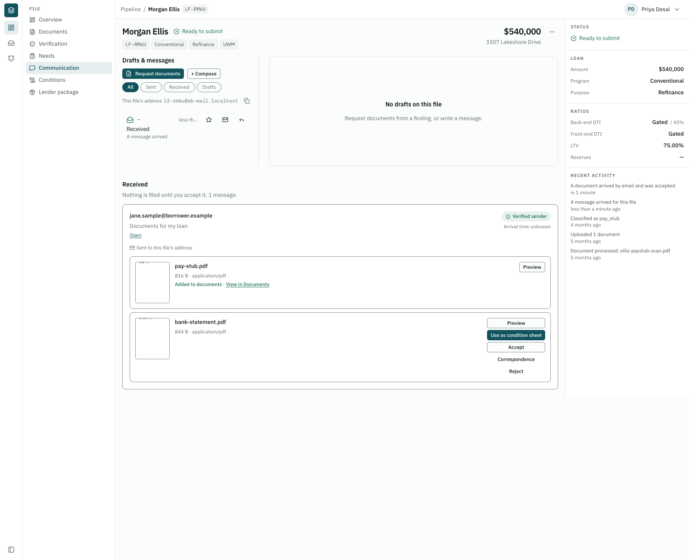
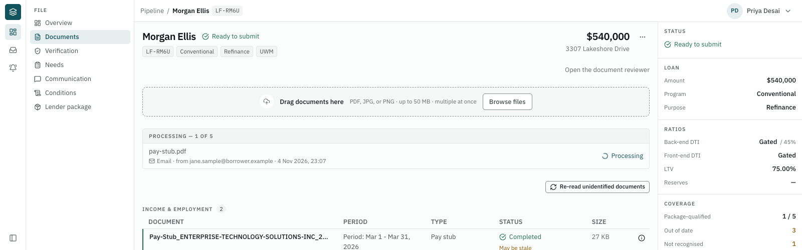
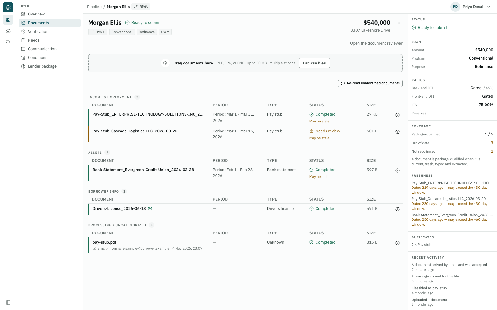
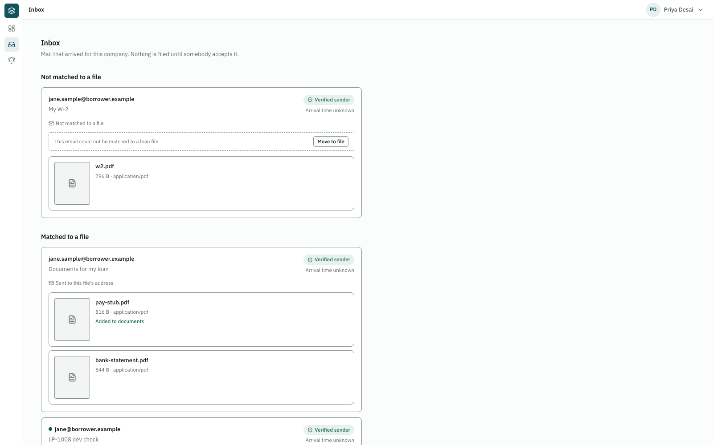
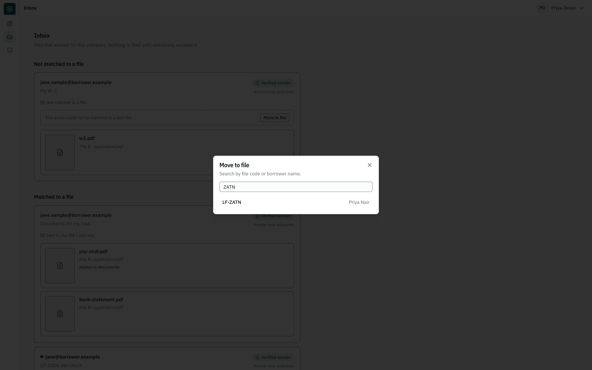
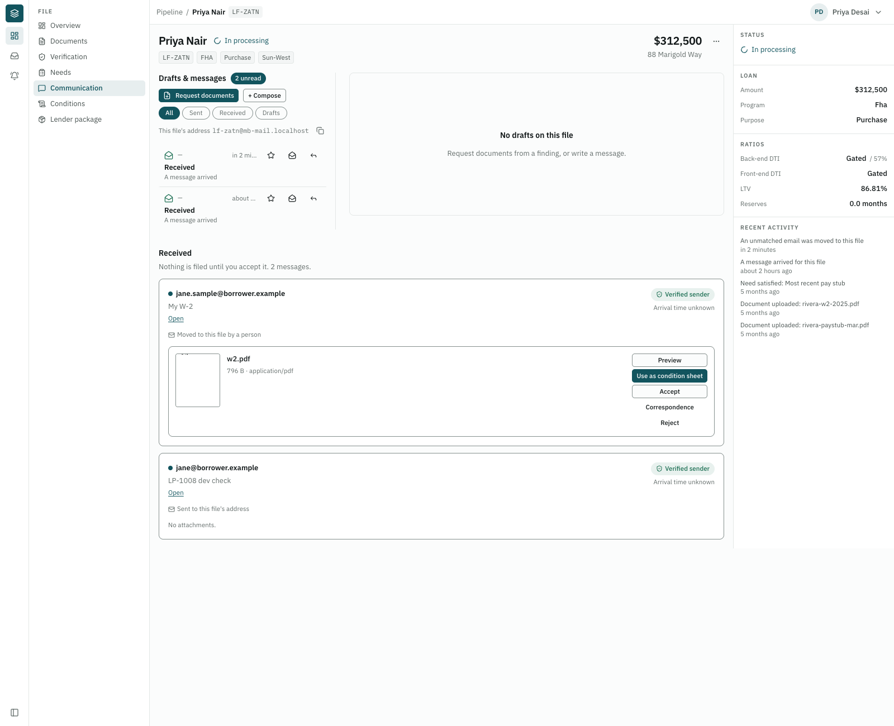
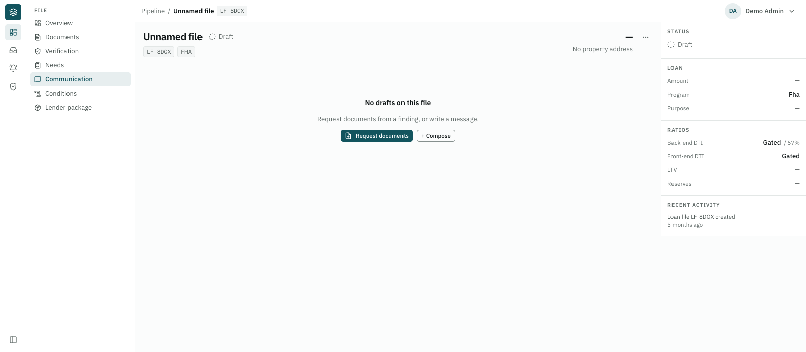
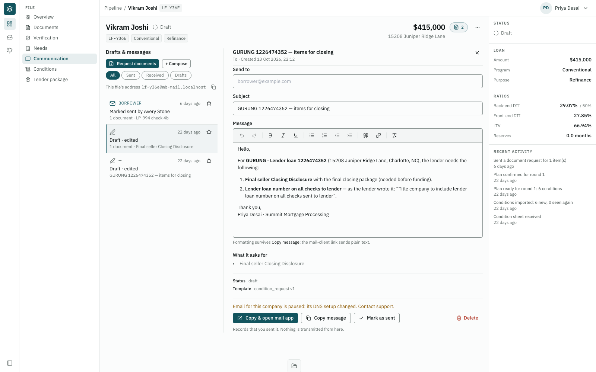

# LP-1009 — Show it on the file

Step 4 (Receive), second ticket. Code, tests and a dev check. Nothing deployed, nothing committed.

## What and why

A processor can now see and act on incoming email:

- **On the Communication tab**, for a company with a mail domain: each email with an unread mark, a
  "Verified sender" or "Not verified" badge, and Preview, Accept and Reject per attachment.
- **After Accept:** "Added to documents" with a "View document" link that opens that document in the reviewer, and the document is labelled "Email · from <sender> ·
  <date>", linking back to the email.
- **In the Inbox:** an email that matched no file appears for its own company, with **Move to file**.
- **In the Send dialog:** when the company's domain has a problem, one line says why Send is missing.

- **Opening an email** shows its subject and text (added after the first report, at your go-ahead; it was the
  first Open item).

## Section 0: the company of unmatched mail

When a message matches no file, the app looks up the domain of each envelope recipient in
`company_mail_domains` with a receiving status (`active` or `problem`). The brief said "not `inactive`"; review
found that this counted a domain still being set up, whose files have no Inbox panel, so it was narrowed to
the same states the file address and the panel use. If every domain has a row and they all belong to
**exactly one** company, the message gets that company and stays unrouted, with no file. Otherwise it has no
company, as before. A virus or DMARC rejection still rejects, with no company.

This is the only source of a company besides a resolved file, and the `inbound_routing.py` module docstring
says so.

**Why it's safe:** a domain is unique to one company (a unique column), and the domain comes from
`receipt.recipients`, where SES says it delivered, not from anything the sender wrote. Recorded as ADR-421.

## What changed

**Backend**

| File | Change |
|---|---|
| `services/inbound_routing.py` | `company_from_delivered_domain`; `move_message_to_file`; `_record_arrival`, shared by routing and Move so neither copies the other; new signal `manual` (confidence 1.0) |
| `services/inbound_triage.py` | `move_unrouted_message`: both ids scoped to the caller's company, and the message row locked so two people can't move it twice |
| `api/inbound.py` | `POST /inbound/messages/{id}/move`: 404 for another company's message or file; 409 if already on a file |
| `api/capabilities.py`, `services/mail_domain.py` | New field `inbox`, per request, from `company_receives_mail` (`active` or `problem`) |
| `api/communications.py` | Opening an arrived message sets `read_at` if empty |
| `services/message_detail.py` | `send_blocked_reason`: the sentence, only when `transmit_blocker` says paused |
| `services/documents.py`, `schemas/document.py` | `email_origin` on list and detail, through `InboundAttachment.document_id` |
| `models/company_mail_domain.py` | `RECEIVING_STATUSES`, moved here because routing and capabilities both read it |
| `schemas/inbound.py` | `communication_id`, `unread`, `document_id` |

No new tables, no migration.

**Why `inbox` is a second field.** `receiving` has two readers: the panel, and the "Add a secure upload link"
button in the Send dialog (`message-dialog.tsx`). The server's upload-link refusal and the sentence offered
in a request (`api/upload_links.py`, `api/communications.py`, `services/email_draft.py`) read
`settings.receiving_enabled` directly. One field could not turn on the panel per company and keep the button
global. `receiving` and those readers are unchanged; the panel now reads `inbox` only, so a company with no
domain gets no panel even if the global switch is on.

**Fields added and why:** `communication_id` so the card can open the message; `unread` for the mark;
`document_id` for the link after Accept; `email_origin` (message id, sender, received date) for the label;
`send_blocked_reason` for the dialog.

**Frontend**

| File | Change |
|---|---|
| `communication/page.tsx` | Upload panel on `receiving`, messages panel on `inbox`, opening a card selects its row |
| `inbound-message-card.tsx` | Unread dot and bold, **Open**, badge wording, Move to file; no more "hidden until claimed", since no route returns another company's mail (ADR-420) |
| `inbound-attachment.tsx` | **Preview** (opens in a new tab), "Added to documents" and link; no endless loading box in the Inbox |
| `move-to-file.tsx` (new) | The picker, using the dashboard's search (`useLoanFiles`): file code or borrower name. There was no existing picker |
| `inbound-messages-panel.tsx` | Scrolls to `#email-<id>` once loaded, for the label's link |
| `message-dialog.tsx` | The paused sentence above the buttons; "This email has no text." or "The email's text could not be read." in place of an empty box |
| `documents/email-origin.tsx` (new) | The label. Shown in the documents table, the processing strip (a new document is there first), the drawer, and the review list (text only, because that row is itself a button) |
| `lib/api/*` | `useMoveMessage`; `inbox`; `capabilities` kept for 5 minutes, not forever, as it now follows the domain; opening or marking a message refreshes both lists |

**Reading the email's text** (added after the first report)

- `message_detail` takes a received email's subject from its `InboundMessage` and its text from the stored
  original, re-read on each open through mail storage. Nothing is copied onto the `Communication`, so the text
  still lives in one place.
- `inbound_triage.raw_message`: the mail-storage read that accept and preview used, split out so the detail
  uses the same bucket check.
- `inbound_mime.body_text`: the plain part, else the HTML part turned into text (scripts and styles dropped),
  else nothing. A forwarded email inside it is not read; its own words are shown, and the forward is an
  attachment. The dialog escapes it like every plain body.
- `body_unavailable` on the detail: True when the original is missing, in another bucket, or fails to parse.
  The dialog then says "The email's text could not be read." An email with only attachments says "This email
  has no text." Either way the dialog still opens with its sender and attachments.

**Review fixes** (one review round, all ten findings fixed at your instruction)

1. **Mark unread now sticks.** The detail response has `marked_read`, true only on the request that marked
   it read. The screen refreshes the lists on that, not on its own cached copy, which "mark unread" never
   updated.
2. **Returning to the browser tab does not open the email again.** The detail query sets
   `refetchOnWindowFocus: false` and `refetchOnReconnect: false`. The app's default was already off for
   focus, so this mostly pins it. "Mark read/unread" updates the open copy in place instead of refetching it,
   since a refetch would mark it read again.
3. **One rule for "receives mail".** Unmatched mail now takes a company only on an `active` or `problem`
   domain (`RECEIVING_STATUSES`), the same as the file address and the panel. See Section 0 and ADR-421.
4. **The Inbox lists in two queries**, not two per email (`_messages_public`). A test counts the statements
   for one and five emails.
5. **The label is plain text when the Communication tab shows no emails** (`inbox` off or not loaded).
6. **A row's own body is kept.** The email's text is used only when the `Communication` has no body, and it
   is always reported as `plain`.
7. **Any storage failure gives "could not be read"**, not a 500, not just `StorageError`.
8. **No extra refreshes on opening an email that was already read** (same change as 1).
9. **"View document" opens that document** (`/review?doc=<id>`). The reviewer already takes `?doc=`, so the
   earlier Open item saying no single-document link existed was wrong.
10. **`lib/api/messages.ts`:** the module comment is back above the imports.

**Choices the brief left open**

- **Signal:** a new value, `manual`, labelled "Moved to this file by a person".
- **Unread count on the tab: skipped.** The file's side menu has no badge pattern. The message list on that
  tab already shows "N unread".
- **Badge:** the existing one, reworded. "Not verified" no longer shows the raw verdict (GRAY), as the brief
  asks for plain words.

## Results

**Dev check** (Summit on `mb-mail.localhost`; real API and Next processes; dev DB; dev injector; Redis db 9, so
no worker processed the accepted document):

1. **Email with two PDFs to LF-RM6U:** one unread dot, "Verified sender", two Preview links, each opening a
   PNG in a new tab (measured: `image/png`, 16,309 and 17,111 bytes). Opening it cleared the dot and showed "Documents for my loan" and "Here are the documents you asked
   for." (screenshot retaken after the fix). Accept showed
   "Added to documents" with a link. The document shows "Email · from jane.sample@borrower.example · 4 Nov
   2026, 23:07", linking to `…/communication#email-<id>`, in the processing strip and in the table (to show
   the table without a worker, I set that one dev row to `completed` by hand).

   
   
   
   
   

2. **Email to `lf-typo@mb-mail.localhost`:** `unrouted`, with Summit's company. Summit's Inbox shows it under
   "Not matched to a file" with its sender. Move to file, search "ZATN", pick LF-ZATN: it left the list and is
   on LF-ZATN, unread, labelled "Moved to this file by a person".

   
   
   

3. **Demo (no domain), LF-8DGX:** no panel.

   

4. **Summit's domain set to `problem`:** the dialog on LF-Y36E shows "Email for this company is paused: its DNS
   setup changed. Contact support." above the buttons. Set back to `active`: the sentence is gone, and the row
   is `active` again. The API ran with `FILE_ADDRESSES_ENABLED=true`, because without an address the first
   reason is "can't send email yet", not the pause.

   

Left in the dev DB: the test emails, and the accepted document on LF-RM6U.

**Tests:** full backend suite 9669 passed, 4 skipped, 1 xfailed. Full frontend suite 2472 passed. `ruff`, `ruff format`, `mypy app` (589 files), `tsc` and `biome` (525 files) clean. New: `tests/services/test_inbound_show_lp1009.py`, `move-to-file.test.tsx`, `inbound-messages-panel.test.tsx`, `lib/api/message-read.test.ts`, and additions to the card, page, dialog and document-list tests. Two LP-806 triage tests now call `_messages_public`.

**Mutation checks** (each restored from a copy):

| Mutation | Failed by |
|---|---|
| Drop the "exactly one company" rule | `test_two_companies_go_to_no_company` |
| Drop the "every domain has a row" rule | `test_one_known_and_one_unknown_domain_goes_to_no_company` |
| Count inactive domains | `test_only_receiving_statuses_name_the_company[inactive-False]` |
| Give a rejected message a company | `test_a_virus_is_still_rejected_with_no_company` |
| Move another company's message | `test_another_companys_message_is_a_404` |
| Move to another company's file | `test_another_companys_file_is_a_404` |
| Move a message already on a file | `test_a_message_already_on_a_file_is_refused` |
| Panel for a company with no domain (`inbox=True`) | `test_inbox_follows_the_companys_domain[verifying-False]` |
| Any company's domain turns the panel on | `test_no_domain_means_no_inbox_even_with_another_company_on` |
| Upload links follow the domain | `test_upload_links_follow_the_global_setting_not_the_domain[False]` |
| `read_at` rewritten on every open | `test_opening_a_message_sets_read_once_and_the_list_shows_it` |
| Any blocker shown as the reason | `test_the_reason_is_returned_only_when_paused[active-False]` |
| Page shows the panel on `receiving` | `communication/page.test.tsx` |
| Hide Move to file | `inbound-message-card.test.tsx` |
| Detail ignores the email's text | `test_opening_a_message_shows_its_subject_and_text` |
| Unreadable original not flagged | `test_a_missing_original_says_so_and_still_opens` |
| Unparseable original not flagged | `test_an_unparseable_original_says_so_and_still_opens` (added after this mutation survived) |
| HTML part preferred over plain | `test_the_plain_part_wins_over_the_html_one` |
| HTML shown as markup | `test_html_only_mail_becomes_plain_text_without_markup_or_script` |
| Dialog always says "no text" | `message-dialog.test.tsx` |
| Review fixes: count `verifying` domains again | `test_only_receiving_statuses_name_the_company[verifying-False]` |
| Review fixes: one query per email | `test_the_inbox_lists_in_the_same_number_of_queries_however_many_emails` |
| Review fixes: replace a row's own body | `test_a_row_with_its_own_body_keeps_it` |
| Review fixes: report the column's format | `test_the_email_text_is_reported_as_plain_whatever_the_column_says` |
| Review fixes: catch only storage errors | `test_a_storage_failure_of_any_kind_still_opens` |
| Review fixes: `marked_read` always true | `test_only_the_open_that_marks_it_read_says_so` |
| Review fixes: refresh lists on every open | `message-read.test.ts` |
| Review fixes: refetch on focus | `message-read.test.ts` |
| Review fixes: refetch instead of updating in place | `message-read.test.ts` |
| Review fixes: label links with `inbox` off | `document-list.test.tsx` |
| Review fixes: link to the Documents tab | `inbound-message-card.test.tsx` |

**Not exercised:** real SES mail; the label's link was checked by its address and a scroll test, not clicked in
a browser. LP-1012 proves the real path.

## Open

1. **Preview shows the first page only.** `attachment_preview` renders one PNG, so a 12-page statement can't be
   checked before Accept. Showing a whole PDF needs a new route that serves the file itself.
2. **Nothing can dismiss an unmatched email.** Spam to a made-up address on a company's domain stays in its
   Inbox, with no reject or delete, and its attachments can't be previewed until it is moved to a file.
3. **The date can be wrong.** `received_at` is the email's own `Date` header, which the sender writes. The label
   falls back to when it arrived if the header is missing, but the card then says "Arrival time unknown".
4. **Opening still writes on a GET, as briefed.** Focus and "mark unread" no longer refetch it, but anything
   else that refetches an open email would mark it read again. A separate "mark read" call on open would end
   this; not done, as the brief asked for the GET.
5. **The timeline row shows "—" for an arrived message's party**, though the pane and card show the sender.
6. **Capabilities in one browser tab.** They are cached for 5 minutes and I found no cache clear on logout, so
   logging in as another company in the same tab can show the wrong panel state for up to 5 minutes. The data
   behind it is still scoped.
7. **The Inbox link shows for companies with no domain**, with nothing in it.
8. **Mail with no company still has no screen.** Files on two companies, or an unknown domain, stay in
    `readonly.inbound_messages` only, and nobody can place them.

## Doc changes (for `docs/email-communication/loan-email.md`, not edited here)

- §3 "Mail with no company": mail delivered to one company's domain now goes to that company (ADR-421); only
  mail that can't be tied to one company stays internal.
- §3 "Finding the file": add that the Inbox's Move to file is how a person places it.
- §5 Status, Step 4: LP-1009 built, not deployed.
- §15c LP-1009: mark ✅ Done when committed. "Move to file" is built; the paused reason is built.
- §15c LP-1012: the typo check now also checks that it appears in that company's Inbox and can be moved.
- §7 (or wherever the Communication tab is described): opening a received email shows its text, re-read from
  the stored original; nothing is copied onto the Communication.
- §18 Log: one line for LP-1009.

## Links

- `docs/email-communication/loan-email.md` §15c (LP-1009), §3 (decisions dated 11-04)
- [LP-1006](LP-1006.md) (Open 4: the reason doesn't reach the screen)
- [LP-1008](LP-1008.md) (reading mail; Open 1: mail with no company)
